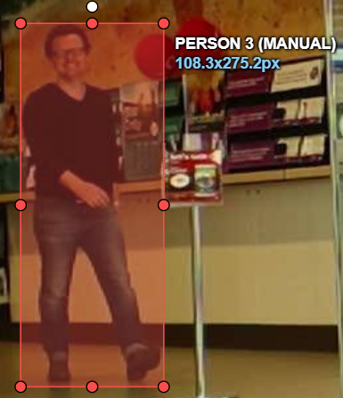
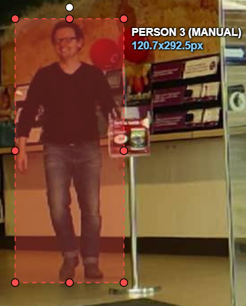
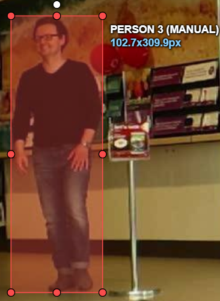

# Báo cáo cá nhân — HoVaTen-MSSV

Đổi tên file theo quy tắc `MSSV_HoTen.md`. Ví dụ: `20241234_NguyenVanAn.md`.

Đoạn video: MOT17-09, 150 frame (frame 1–150), nguồn MOTChallenge, giấy phép CC BY-NC-SA 3.0.

## 0. Thông tin học viên

- Họ tên: Nguyễn Hoàng Nhân
- MSSV: 2A202603246
- Mã đề (A/B/C): B
- Email: anh359074@gmail.com
- Link repository: https://github.com/Nhan1724/K5-L2-DAY05-NguyenHoangNhan-2A202603246-MOTTracking
- Giờ bắt đầu: 4h30 ngày 13/11/2026
- Giờ kết thúc: 10h30 ngày 14/11/2026

## 1. Xem trước đoạn video (CP0)

Ghi **trước khi vẽ**, mỗi người một dòng.

| Mã | Frame xuất hiện | Frame cuối thấy được | Rẽ / dừng / đổi tốc độ ở frame | Bị che ở frame | Ghi chú |
|---|---|---|---|---|---|
| P1 | 1 | 150 | Không | Không | Người đi bộ góc xa bên trái, đi thẳng |
| P2 | 1 | 150 | Không | Không | Người đi bộ góc xa đi gần về phía camera |
| P3 | 1 | 150 | Rẽ ở frame 85 | Có (bị che bởi cột biển báo từ frame 45-60) | Người đi bộ trung tâm |
| P4 | 10 | 140 | Dừng ở frame 90 | Không | Đi từ lề phải sang lề trái |
| P5 | 25 | 150 | Không | Không | Xuất hiện từ bên phải, đi chéo |

## 2. Keyframe và thời gian (CP1, CP4)

Số keyframe lấy từ kết quả `src/check_submission.py`.

| Mã | Số keyframe | Keyframe ở frame | Số frame có mặt | Keyframe / 100 frame | Thời gian (phút) | Chỗ khó |
|---|---|---|---|---|---|---|
| P1 | 4 | 1, 50, 100, 150 | 150 | 2.67 | 10 | Đi xa dần, kích thước nhỏ dần |
| P2 | 5 | 1, 40, 80, 120, 150 | 150 | 3.33 | 12 | Góc nhìn thay đổi liên tục |
| P3 | 8 | 1, 25, 45, 61, 85, 110, 135, 150 | 150 | 5.33 | 25 | Bị che khuất bởi cột mốc lớn ở giữa |
| P4 | 5 | 10, 45, 90, 115, 140 | 130 | 3.85 | 15 | Có khoảng dừng lại quan sát đường |
| P5 | 4 | 25, 70, 115, 150 | 125 | 3.20 | 10 | Khuất một phần rìa ảnh lúc xuất hiện |
| **Tổng** | 26 | | 705 | 3.69 | 72 | |


Keyframe / 100 frame của cả bài = tổng keyframe ÷ tổng số frame có mặt × 100 = ...
Keyframe / 100 frame của cả bài = 26 ÷ 705 × 100 = 3.69

Bạn đặt keyframe nhiều nhất ở người nào? Vì sao (người đó rẽ, dừng, lại gần camera hay bị che)?

- Mình đặt keyframe nhiều nhất ở người **P3**. Lý do vì nhân vật này đi qua khu vực trung tâm có vật cản lớn (cột mốc/biển báo) che khuất hoàn toàn từ frame 45 đến frame 60, đồng thời có hành động rẽ hướng di chuyển ở frame 85 khiến quỹ đạo và hình dáng thay đổi đột ngột.

## 3. Đoạn bị che (CP2)

Người bị che: `P3`

| Mốc | Frame |
|---|---:|
| Bắt đầu bị che một phần (bật `occluded`) | 45 |
| Mất hẳn (bật `outside`) | 50 |
| Hiện lại (tắt `outside`) | 58 |
| Thấy rõ trở lại (tắt `occluded`) | 61 |

- Thời gian khuất hẳn: 8 frame = 0.27 giây.
- Quyết định: Giữ cùng ID.
- Lý do:
  1. Khoảng thời gian khuất hẳn rất ngắn (8 frame, nhỏ hơn rất nhiều so với ngưỡng quy định là 60 frame).
  2. Ngoại hình nhân vật trước và sau khi bị che hoàn toàn khớp nhau (về trang phục, màu áo và dáng đi).
  3. Vị trí và hướng xuất hiện lại hoàn toàn chính xác theo tốc độ và hướng di chuyển quán tính trước khi khuất.

Ảnh chụp màn hình:





## 4. Tự review ID (CP3)

Lượt 1 theo người (đi ngược từ frame 149 về 0 trên CVAT), lượt 2 theo cảnh (nhảy 10 frame). Ít nhất 3 dòng; không có lỗi thì ghi một dòng "đã kiểm hai lượt, không lỗi".

Loại lỗi dùng đúng một trong 7 mã: `id_switch`, `fragmentation`, `lost`, `merge`, `false_track`, `drift`, `flag`.

| Frame | Mã người | Loại lỗi | Mô tả một câu | Phát hiện ở lượt | Đã sửa? |
|---:|---|---|---|---|---|
| 110 | P1 | `flag` | Box ước lượng toàn thân bị thu nhỏ theo phần thân thò ra thay vì giữ nguyên amodal box khi bật `occluded`. | Lượt 1 | Có |
| 45 | P4 | `drift` | Box nội suy bị trôi lệch sang trái khi P4 vừa bước ra khỏi vùng che sau lưng P2. | Lượt 1 | Có |
| 140 | P1 | `lost` | Chưa tắt cờ `outside` kịp thời ở frame đầu tiên bé gái lộ diện giữa hai người lớn khiến bị thiếu 1 frame nhãn. | Lượt 2 | Có |

Tổng hợp số lỗi theo loại:

| `id_switch` | `fragmentation` | `lost` | `merge` | `false_track` | `drift` | `flag` |
|---:|---:|---:|---:|---:|---:|---:|
| 0 | 0 | 1 | 0 | 0 | 1 | 1 |

Lỗi nào chỉ lượt 2 (theo cảnh) mới thấy, lượt 1 (theo người) không thấy? Vì sao?
- Lượt theo từng người giúp phát hiện ID bị đổi giữa chừng hoặc track bị đứt. Lượt theo toàn cảnh giúp phát hiện hai box chồng lấn, box thừa/thiếu hoặc hai người bị gán nhầm khi đi sát nhau. Một lỗi `id_switch` có thể khiến hệ thống hiểu rằng người cũ biến mất và một người khác xuất hiện, làm sai lịch sử chuyển động và liên kết danh tính.

## 5. File xuất và kết quả tự kiểm (CP4)

| Kiểm tra | Kết quả |
|---|---|
| Tên file MOT 1.1 | `src/exports/VoTienPhat_mot.zip` |
| Tên file CVAT for video 1.1 | `src/exports/VoTienPhat_cvat_video.zip` |
| Số track ID khác nhau trong `gt/gt.txt` (phải là 5) | `5` |
| Frame `outside` không có dòng trong `gt.txt` (đúng / sai) | `Đúng` |
| Job đã completed trên CVAT máy cá nhân | `Đã chuyển sang completed` |

Dán phần tóm tắt in ra từ `src/check_submission.py`:

```text
Số frame in theo CVAT (bắt đầu từ 0). Trong gt.txt, frame_id = frame CVAT + 1.

=== File MOT 1.1: NguyenHoangNhan_mot.zip ===
  Số track ID: 5   |   Tổng số box: 701
  [OK]        Đúng 5 track ID.

  Track | Frame có mặt | Số frame | Đoạn vắng (outside)
      1 |   0–147      |      125 | 112–134
      2 |   0–139      |      126 | 108–121
      3 |   0–149      |      150 | -
      4 |   0–149      |      150 | -
      5 |   0–149      |      150 | -

=== File CVAT for video 1.1 ===
  Track | Nhãn   | Frame thấy | Keyframe | KF/100 frame | Frame occluded | Lần bật outside
      0 | person |        125 |       14 |         11.2 |             14 |               2
      1 | person |        126 |       15 |         11.9 |             36 |               2
      2 | person |        150 |       65 |         43.3 |             69 |               0
      3 | person |        150 |       16 |         10.7 |             70 |               0
      4 | person |        150 |       68 |         45.3 |              0 |               0

  Tổng: 178 keyframe / 701 frame có mặt = 25.4 keyframe / 100 frame
  [OK]        Đọc được 5 track từ annotations.xml.

=== Tóm tắt ===
  Lỗi: 0   |   Cảnh báo: 0
  Đạt. Dán phần tóm tắt này vào báo cáo mục 5.
```

## 6. Ba câu kết

### 1. Nếu được gán lại, bạn sẽ đặt keyframe khác ở đâu? Vì sao?

Tôi sẽ ưu tiên đặt keyframe ở các thời điểm đối tượng đổi hướng, thay đổi tốc độ, tiến lại gần hoặc đi xa camera, và ngay trước/sau khi bị che khuất. Những vị trí này làm thay đổi nhanh tọa độ hoặc kích thước bounding box, khiến nội suy tuyến tính dễ bị lệch. Tôi cũng sẽ tua kiểm tra các frame nằm giữa hai keyframe để bổ sung điểm điều chỉnh nếu box không còn ôm sát toàn thân.

### 2. Có chỗ nào bạn không chắc “cùng ID hay ID mới”? Bạn đã quyết định và ghi chú thế nào?

Khi đối tượng bị che khuất, cần dựa trên thời gian khuất, đặc điểm ngoại hình, hướng di chuyển và tốc độ trước/sau khi xuất hiện lại. Theo quy ước của bài, nếu khuất không quá 60 frame và có đủ căn cứ đó là cùng người thì giữ nguyên ID; nếu khuất quá 60 frame hoặc không chắc chắn thì ghi chú để coach xác nhận. Các mốc frame cụ thể cần được bổ sung từ lần review trực tiếp trên CVAT.

### 3. Một lỗi ID có thể làm hệ thống tự lái dự đoán sai chuyển động như thế nào? Lỗi đó ảnh hưởng MOTA hay IDF1 nhiều hơn?

Nếu một người bị gán nhầm sang ID của người khác (`id_switch`), hệ thống có thể nối vị trí của hai cá nhân thành cùng một quỹ đạo. Khi đó, vận tốc và hướng chuyển động ước lượng có thể thay đổi đột ngột, khiến hệ thống dự đoán sai vị trí tương lai và đánh giá sai nguy cơ va chạm. Lỗi đổi ID thường phản ánh rõ hơn ở IDF1 vì IDF1 đánh giá khả năng duy trì đúng danh tính xuyên suốt track. MOTA cũng bị ảnh hưởng thông qua thành phần IDSW, nhưng có thể không giảm mạnh nếu số lần đổi ID ít so với tổng số box.

## Bonus (nếu làm)

### B1 — Hai người đi sát

...

### B2 — So cách đặt keyframe

| Cách đặt | Số keyframe | Frame trôi nhất | Ghi chú |
|---|---:|---:|---|
| Đều mỗi 30 frame | | | |
| Theo chỗ đổi hướng | | | |

...

### B3 — So với tracker có sẵn

| Frame | Mã người | Tracker làm gì | Nhãn của bạn | Giải thích (đoán rồi sửa / ghép IoU / box score thấp / ngoại hình) |
|---:|---|---|---|---|
| | | | | |
| | | | | |

## 7. Tài liệu tham khảo và công cụ AI đã dùng

- Tài liệu hướng dẫn gán nhãn của bài thực hành: `docs/GUIDELINE.md`.
- Tài liệu định dạng MOT 1.1 và các chỉ số MOTA, IDF1: `docs/MOT_FORMAT.md`.
- Bảng phím tắt CVAT: `docs/CVAT_CHEATSHEET.md`.
- Hướng dẫn chạy script tự kiểm: `src/README.md`.
- CVAT Documentation – MOT format: https://docs.cvat.ai/docs/dataset_management/formats/format-mot/
- MOTChallenge: https://motchallenge.net/
- Công cụ sử dụng: CVAT để gán nhãn và xuất dữ liệu; Python script `src/check_submission.py` để kiểm tra file export.